# Progetto: tracciabilità della produzione, qualità e comunicazioni

**Riepilogo funzionale e modello UML concettuale — 22 novembre 2026**

I diagrammi utilizzano Mermaid. In VS Code, aprire l'anteprima Markdown con **Ctrl+Maiusc+V**. Il file di testo originale rimane invariato.

## 1. Scopo e stato del progetto

Il progetto descrive una linea produttiva di lattine, dalla raccolta dei dati alla preparazione dei pallet, al controllo qualità, alla gestione degli ordini e alla produzione di certificati.

Il sistema dovrà inoltre consentire comunicazioni tra funzioni aziendali, gestione delle non conformità, interventi di manutenzione, consultazione di procedure operative (SOP), analisi statistiche e tracciabilità delle decisioni.

**Stato del documento:** questo è un modello concettuale. Classi, relazioni, processi e strutture proposte non sono necessariamente già implementati.

### Base esistente osservata

- Progetto Java/Maven `Creazione_Database`, con generatori FE, BE, PF e Ordini.
- Il generatore FE usa `FE_DB` e la collection `cupper01_samples`.
- Il generatore BE legge `FE_DB` e usa `BE_DB` / `be_spray_samples`.
- Il generatore PF legge `BE_DB` e usa `PF_DB` / `pallets`.
- Il generatore Ordini definisce le tabelle MySQL `ordini` e `pallet_ordine`.
- Il riepilogo esistente descrive il flusso FE → BE → PF → Ordini → PDF.

La presenza dei generatori non dimostra che tutti i processi, la sicurezza, la sincronizzazione e i certificati qui descritti funzionino già dall'inizio alla fine.

## 2. Organizzazione del flusso produttivo

```mermaid
flowchart LR
    FE["FE_DB<br/>Dati iniziali e campioni"]
    BE["BE_DB<br/>Semilavorati e misure spray"]
    PF["PF_DB<br/>Pallet prodotto finito"]
    CQ["Controllo qualità<br/>Valutazione e decisione"]
    ORD["MySQL<br/>Ordini e pallet rilasciati"]
    PDF["Certificato PDF<br/>Qualità e tracciabilità"]

    FE -->|"FIFO, ritardo 30 min"| BE
    BE -->|"FIFO, max 968 lattine per pallet"| PF
    PF --> CQ
    CQ -->|"Solo pallet rilasciati OK"| ORD
    ORD --> PDF
```

### Parametri del progetto esistente

- Ritardo FE → BE: **30 minuti**.
- Elaborazione FIFO; BE → PF ordinata per `timestamp` e `minuteIndex`.
- Capacità pallet: fino a **968 lattine**; l'ultimo può essere parziale.
- Tempo indicativo di preparazione: **3 minuti per pallet**.
- Stati iniziali e di qualità: `PENDING`, `OK` e `KO`.
- Il conteggio degli ordini considera i pallet rilasciati `OK`.

Ogni ordine riguarda **esattamente un prodotto**. Un prodotto può comparire in più ordini. Ogni pallet appartiene a **esattamente un ordine**; un ordine può avere più pallet.

Il numero di pallet previsti può essere calcolato come `ceil(quantità ordine / 968)`; il numero effettivo di pallet OK è distinto dal numero previsto.

Nel riepilogo originario la chiave pallet include ordine, progressivo, timestamp e stato. Poiché lo stato può cambiare e il timestamp ISO contiene due punti, si propone un **ID pallet immutabile** per i collegamenti. La chiave esistente rimane un dato di compatibilità, con migrazione da progettare.

## 3. Personale, funzioni e autorizzazioni

| Funzione | Ruoli |
|---|---|
| Qualità | Operatore CQ e Manager Qualità |
| Manutenzione | Operatori e Manager Manutenzione |
| Produzione | Operatori e Manager Produzione; attività FE, BE e FineLinea |
| Logistica | Operatori e Manager Logistica |
| Vendite | Manager Vendite |
| Finanza | Manager Finanza |

Un utente autenticato può ricevere uno o più ruoli e appartenere a gruppi di colleghi. Sono previsti gruppi tra manager e relazioni responsabile-collaboratore. L'appartenenza a un gruppo non conferisce automaticamente accesso a tutte le informazioni.

### Matrice minima delle autorizzazioni

| Operazione | Ruolo autorizzato |
|---|---|
| Rilascio produzione / pallet | Operatore CQ o Manager Qualità |
| Rilascio certificato | Operatore CQ o Manager Qualità |
| Autorizzazione modifica SOP qualità | Solo Manager Qualità |
| Modifica SOP manutenzione | Solo Manager Manutenzione |
| Modifica SOP produzione | Solo Manager Produzione |

Per le SOP qualità è specificata l'autorità di approvazione; chi possa proporre o redigere una modifica è da definire. Permessi di lettura, ruoli amministrativi e gestione delle deleghe restano da definire. Le autorizzazioni devono essere verificate al momento dell'azione, non soltanto nascondendo funzioni nell'interfaccia.

## 4. Database e responsabilità

### MongoDB — documenti operativi

- `FE_DB`: campioni iniziali e dati di semilavorato.
- `BE_DB`: campioni spray, semilavorati e riferimenti alla fase FE.
- `PF_DB`: pallet, riferimenti alle misure e informazioni di controllo.
- Database proposto per comunicazioni e qualità: conversazioni, messaggi, segnalazioni, occorrenze, controlli e interventi di manutenzione. La suddivisione fisica definitiva è da progettare.

### MySQL — dati relazionali

- Ordini, prodotto associato, quantità, tracciatura e conteggi dei pallet OK.
- Anagrafica del personale autorizzato, ruoli e assegnazioni, separata logicamente dagli ordini.
- Informazioni e permessi del personale sono la fonte di riferimento per le verifiche di autorizzazione.

### Neo4j — grafo delle relazioni

- Nodi e collegamenti fra utenti, problemi, macchine, interventi, SOP, misure, pallet, ordini e certificati.
- Consente di navigare, ad esempio, da una non conformità alla macchina, all'intervento, alla versione SOP e ai pallet interessati.
- I nodi contengono identificativi e riferimenti; il grafo non sostituisce le fonti autorevoli di dati e permessi.

### Archivio documentale

Conserva file SOP, allegati, fotografie e certificati PDF. I database conservano riferimenti, metadati e versioni pertinenti. Accesso, integrità, conservazione e disponibilità dei file sono da progettare; l'archivio non implica necessariamente un ulteriore database.

### Pro e contro

| Tecnologia | Vantaggi | Svantaggi |
|---|---|---|
| **MongoDB** | Documenti flessibili per misure, messaggi e contenuti variabili; dati correlati e riferimenti alle fonti. | Relazioni e vincoli tra documenti richiedono progettazione accurata; documenti troppo grandi non sono appropriati. I messaggi saranno documenti separati. |
| **MySQL** | Vincoli, relazioni e transazioni adatti a ordini, ruoli e autorizzazioni; schema strutturato. | Meno flessibile per strutture molto variabili; non garantisce da solo la coerenza con gli altri sistemi. |
| **Neo4j** | Relazioni complesse e percorsi di tracciabilità espliciti e navigabili. | Richiede competenze e infrastruttura aggiuntive; il grafo va sincronizzato e protetto e può non riflettere immediatamente l'ultima modifica. |

L'uso combinato dei tre sistemi aumenta la complessità operativa: occorrono identificativi stabili, gestione dei fallimenti, riconciliazione, backup e controlli di accesso coerenti.

## 5. Legenda UML

| Molteplicità | Significato |
|---|---|
| `1` | Esattamente una istanza |
| `0..1` | Nessuna oppure una |
| `0..*` | Nessuna, una o molte |
| `1..*` | Una o molte |

Le molteplicità sono indicate **accanto all'estremità della classe**. Per esempio:

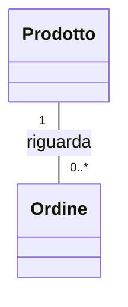

Ogni ordine riguarda un prodotto; un prodotto può riguardare zero o molti ordini. Una relazione molti a molti può richiedere un'entità associativa per conservare data, ruolo, quantità o provenienza.

Gli schemi rappresentano associazioni concettuali. Non specificano ereditarietà o composizione UML dove non è stata concordata una dipendenza di ciclo di vita. Le frecce nei diagrammi di attività indicano il flusso, non cardinalità. I diagrammi di flusso in Mermaid sono rappresentazioni leggibili delle attività, non una notazione UML formale completa.

## 6. UML delle classi: produzione, ordini e qualità

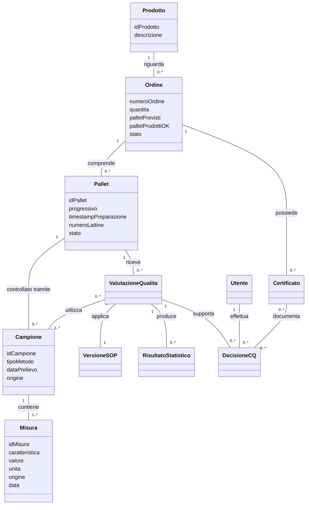

| Relazione | Tipo e significato |
|---|---|
| Prodotto–Ordine | Uno a molti: ogni ordine riguarda un prodotto; un prodotto può comparire in più ordini. |
| Ordine–Pallet | Uno a molti: ogni pallet appartiene a un ordine; un ordine può comprendere più pallet. |
| Pallet–Campione | Uno a molti: un pallet può essere controllato tramite più campioni. |
| Campione–Misura | Uno a molti: un campione contiene una o più misure. |
| Valutazione–Campione | Molti a molti: una valutazione usa uno o più campioni; un campione può essere usato in valutazioni successive se il metodo lo consente. |
| Valutazione–Versione SOP | Molti a uno: ogni valutazione fa riferimento a una versione della SOP. |
| Ordine–Certificato | Uno a molti: un ordine può avere più versioni del certificato. |

Una valutazione può contenere risultati per più caratteristiche, compresa l'eventuale impossibilità di calcolo. Una decisione CQ identifica utente, momento, esito, motivazione ed eventuale deroga; le decisioni precedenti non vengono cancellate. Ogni certificato documenta le decisioni pertinenti tramite riferimenti e fotografia dei dati.

L'associazione tra dati FE/BE, campioni e pallet deve conservare la provenienza effettivamente disponibile: non si presume che ogni misura disponibile identifichi univocamente una specifica lattina.

Le caratteristiche, i vincoli di prodotto e le informazioni dei lotti sono da dettagliare. Le cardinalità sono proposte, salvo le relazioni ordine-prodotto e ordine-pallet confermate.

## 7. UML delle classi: utenti, chat e segnalazioni

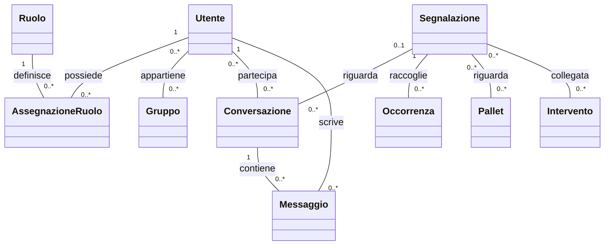

| Classe | Informazioni principali |
|---|---|
| Utente | Identificativo, stato, funzione e riferimenti ai ruoli. |
| AssegnazioneRuolo | Utente, ruolo, eventuale ambito e periodo di validità. |
| Gruppo | Identificativo, nome, funzione e membri autorizzati. |
| Conversazione | Partecipanti, eventuale segnalazione e regole di accesso. |
| Messaggio | Autore, data, contenuto, riferimenti ad allegati e conversazione. |
| Segnalazione | ID immutabile, descrizione, categoria, stato, responsabile, riferimenti, date e storico. |
| Occorrenza | Rilevazione o informazione associata alla segnalazione, origine, ID sorgente quando disponibile e data. |

La relazione Utente–Ruolo è **molti a molti**, tramite `AssegnazioneRuolo`. Utente–Gruppo e Utente–Conversazione sono molti a molti. Una conversazione può essere generica o collegata a una segnalazione; una segnalazione può avere più conversazioni. Sono possibili anche riferimenti a ordini, macchine o altri oggetti.

## 8. UML delle classi: manutenzione, SOP e autorizzazioni

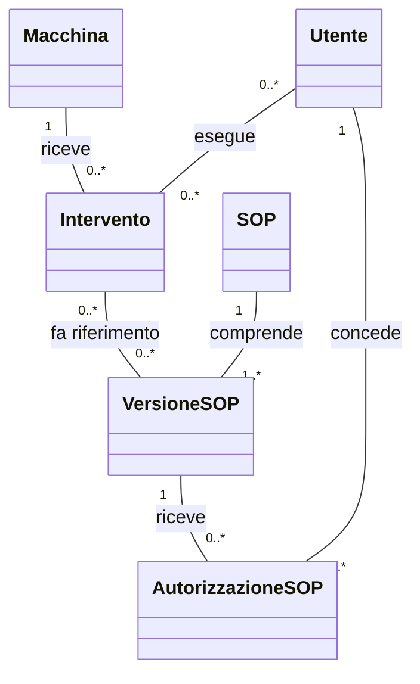

| Classe | Informazioni principali |
|---|---|
| Intervento | Macchina, operatori, tipo, data, attività, esito e allegati. |
| SOP | Identità, titolo e categoria: produzione, manutenzione o qualità. |
| VersioneSOP | Numero/versione, stato, validità, riferimento al file e storico. |
| AutorizzazioneSOP | Utente, azione, data e motivazione. |

Una macchina può avere più interventi. Più operatori possono partecipare allo stesso intervento e un operatore a più interventi. Un intervento può fare riferimento a più versioni SOP. Ogni versione appartiene a una sola SOP. Un intervento può essere registrato senza una segnalazione.

## 9. Attività: produzione e preparazione pallet

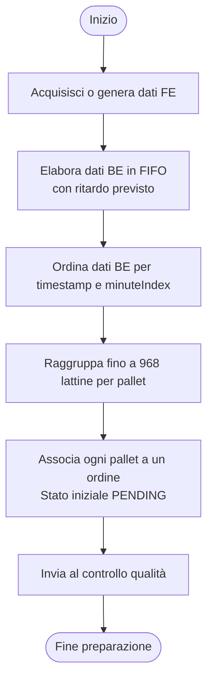

Il passaggio al conteggio dei pallet OK avviene solo dopo una decisione CQ autorizzata. Il comportamento nei casi di dati mancanti o non utilizzabili deve essere definito senza convertirli in misure valide.

## 10. Attività e stati: controllo qualità e rilascio

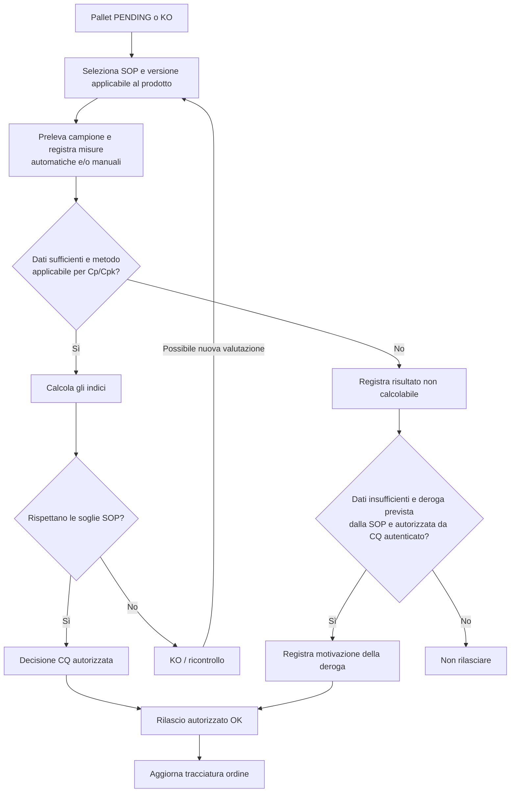

Solo operatore CQ o Manager Qualità può rilasciare la produzione. La deroga concordata riguarda **dati insufficienti**, non un risultato calcolato non conforme. Non si registrano valori Cp/Cpk inventati o considerati conformi. Una deroga deve essere prevista nella SOP e riportata nel certificato.

### Stati concettuali del pallet

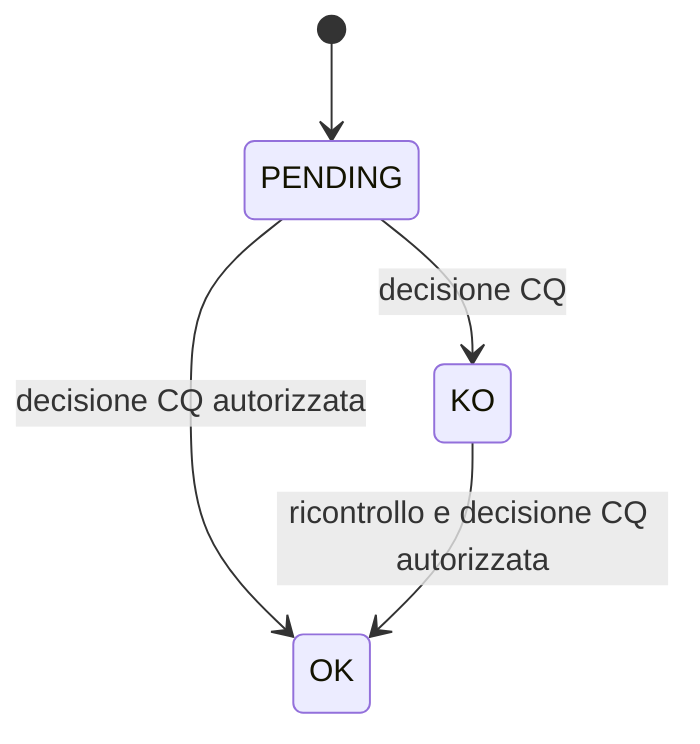

Le decisioni, le misure e gli esiti precedenti rimangono nello storico. Altre transizioni, inclusa l'eventuale revoca di un rilascio, sono da definire.

## 11. Attività: comunicazioni e non conformità

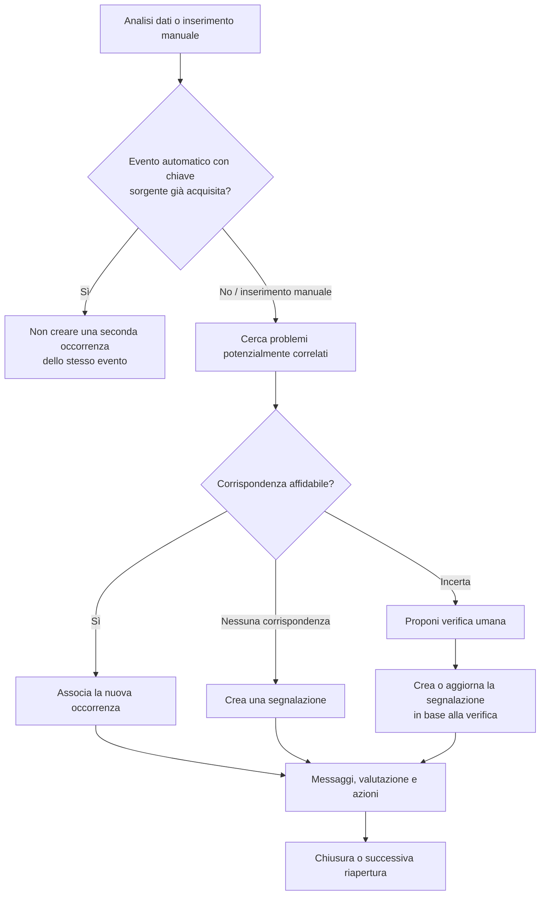

La segnalazione ha un ID proprio e stabile. L'ID dell'evento sorgente serve a riconoscere una stessa acquisizione automatica ripetuta; non basta il solo tipo di prodotto per stabilire che due problemi siano identici. Nuove occorrenze possono riguardare un problema già noto senza essere duplicati. Il criterio di correlazione e l'eventuale revisione umana sono da definire. Messaggi generici possono esistere senza alcuna segnalazione.

## 12. Attività: manutenzione e gestione SOP

### Manutenzione

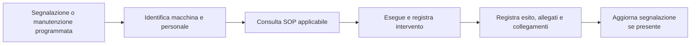

### Gestione delle SOP

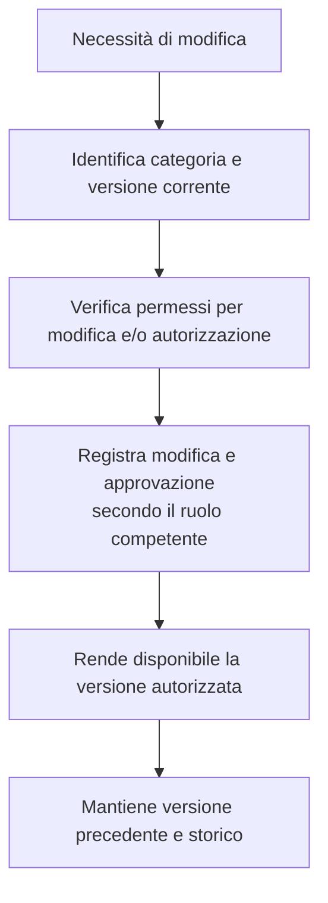

Per la qualità, l'autorizzazione della modifica è riservata al Manager Qualità. Per manutenzione e produzione, la modifica è riservata ai rispettivi manager. Flussi dettagliati di redazione, approvazione e pubblicazione rimangono da definire.

## 13. UML di sequenza: dal controllo al certificato

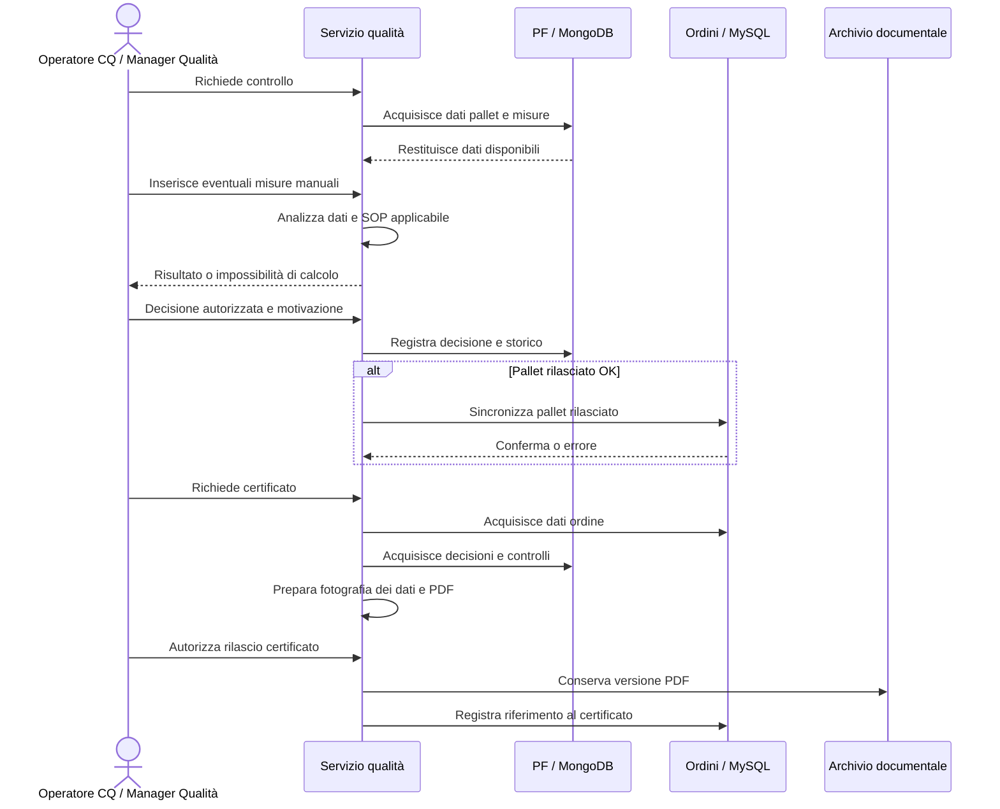

Lo schema descrive responsabilità logiche, non una transazione unica tra database diversi. Gli aggiornamenti devono essere affidabili e idempotenti: una ripetizione non deve contare due volte lo stesso pallet. Errori di sincronizzazione devono essere visibili e recuperabili; il meccanismo tecnico, ad esempio eventi persistenti con nuovi tentativi, è da progettare.

## 14. Analisi statistica e certificazione

Per ciascuna caratteristica la SOP deve individuare, tra l'altro, limiti di specifica LSL/USL, soglie richieste, metodo di campionamento e calcolo. Le misure manuali registrano operatore, momento, metodo, unità e provenienza.

Quando appropriato e previsto dal metodo:

```text
Cp  = (USL - LSL) / (6 × sigma)
Cpk = min((USL - media) / (3 × sigma),
          (media - LSL) / (3 × sigma))
```

La stima di sigma, le condizioni di applicabilità, la stabilità del processo, la numerosità minima e la gestione di distribuzioni non adatte sono da definire nella SOP. Cp/Cpk non devono essere calcolati o presentati come validi quando i dati o il metodo non lo consentono. Pp/Ppk possono essere valutati separatamente, se previsti dal metodo.

Distinguere:

- Valutazione del campione del singolo pallet e suo eventuale ricontrollo.
- Analisi della capacità del processo sui dati produttivi pertinenti, senza selezionare soltanto i pallet rilasciati.
- Decisione CQ, inclusa l'eventuale deroga per dati insufficienti.

Un campione e i relativi indici non dimostrano la conformità di ogni singola lattina. L'estensione delle conclusioni deve essere esplicitata nel risultato e nel certificato.

### Contenuto del certificato

- Identificativo ordine e prodotto, pallet previsti e pallet rilasciati OK.
- Riferimenti ai pallet e alle rispettive decisioni di rilascio.
- Controlli iniziali, ricontrolli, passaggi KO → OK e relative motivazioni.
- Risultati statistici, metodi, campioni e limiti applicati.
- Risultati non calcolabili e deroghe, se presenti.
- Personale CQ autorizzante, date e versioni delle SOP.
- Riferimenti ad analisi, commenti e allegati pertinenti.

Ogni emissione conserva una fotografia identificabile dei dati e dei metodi usati. Una nuova versione non deve cancellare o modificare silenziosamente il certificato precedente.

## 15. Grafo Neo4j: esempi di nodi e relazioni

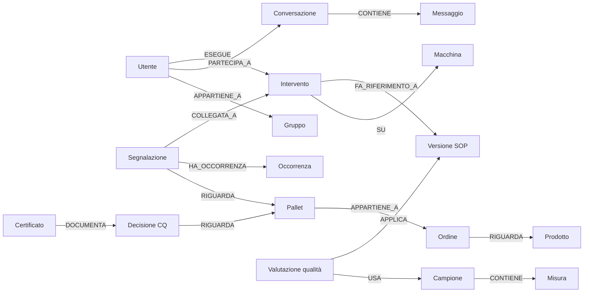

Questi nomi sono esempi concettuali, non uno schema Neo4j già implementato. Il grafo usa ID stabili e rispetta i permessi delle informazioni collegate.

## 16. Decisioni e analisi ancora necessarie

1. Definire le caratteristiche da controllare per ogni prodotto, le unità, LSL/USL e le soglie Cp/Cpk nelle SOP appropriate.
2. Definire prelievo, rappresentatività, numero minimo di campioni, trattamento delle misure automatiche e manuali e metodo statistico.
3. Formalizzare la deroga per dati insufficienti nella SOP, inclusi motivazione, evidenze, autorizzazione e contenuto del certificato.
4. Definire ricontrollo, criteri per KO → OK, eventuali revoche e conseguenze sul conteggio ordini e su certificati già emessi.
5. Definire permessi di lettura, gruppi, deleghe e amministrazione utenti; stabilire chi può redigere le modifiche alle SOP qualità.
6. Definire chiavi sorgente, criteri di correlazione delle segnalazioni, revisione umana e gestione dei casi ambigui.
7. Progettare identificativi stabili, compatibilità con la chiave pallet esistente, integrità dei riferimenti e associazione effettiva delle misure.
8. Progettare sincronizzazione, idempotenza, errori, recupero e riconciliazione fra MongoDB, MySQL, Neo4j e archivio documentale.
9. Definire autenticazione, audit, riservatezza, conservazione, backup e ripristino secondo le esigenze organizzative applicabili.
10. Verificare codice e ambiente esistenti prima dell'integrazione e stabilire quali funzionalità siano effettivamente già operative.
